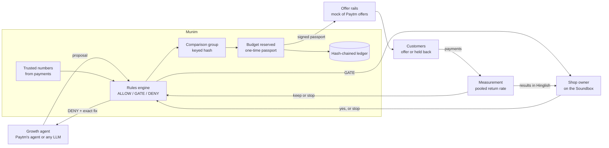

# Munim

**The CFO for every merchant's AI growth agent.**

AI agents are starting to run cashback offers for small shops. Munim sits between a merchant's growth agent and the offer rails. It checks every offer against the shop owner's own rules before a rupee moves, keeps a comparison group so the result can be measured, stops offers that don't pay, and tells the owner everything on the Soundbox, in Hinglish.

- **Live demo:** https://saksham869.github.io/munim/ (replay a three-week run, then try to make Munim overspend)
- **Pitch deck:** [docs/Munim_Pitch.pdf](docs/Munim_Pitch.pdf) ([PowerPoint](docs/Munim_Pitch.pptx))
- Built for the Paytm Build for India AI Hackathon, Delhi 2026, **Track 1: Merchant Growth AI**

> A hackathon prototype on a synthetic shop, with a mock offers API. Not a Paytm product, and no Paytm data is used.

---

## The problem, on one bill

The growth agent's first idea for a kirana: **₹40 cashback on any bill over ₹100**, for every regular who stopped coming.

- **It gives away more than the bill earns.** A ₹100 bill earns the shop ₹12 at a 12% margin. Paying ₹40 back loses ₹28 every time the offer is used.
- **It pays people who were coming anyway.** About 22 in 100 of these regulars return within two weeks with no offer at all. They get the cashback too.
- **Nobody can tell whether it worked.** With no one held back for comparison, a losing offer looks like a winning one and keeps running.

Prompt guardrails catch none of this, because none of it is a bad prompt. It is arithmetic. **Guardrails stop bad prompts. Munim stops bad spending.**

## What Munim does

1. **The growth agent proposes** an offer: who gets it, how much cashback, on what minimum bill. It cannot pay anyone.
2. **Munim decides** with numbers it computed itself from the shop's payments: **ALLOW**, **GATE** (the owner must say yes) or **DENY** with the exact numbers that would pass.
3. **The owner taps *Haan*** on the Soundbox screen (or in the app) when an offer needs a yes. One sentence, *"Munim, sab band karo"*, cancels running offers and holds every new one for his yes.
4. **Munim reserves the budget and signs a one-time passport**; only then do the offer rails send the offer.
5. **Measurement compares** customers who got the offer with those held back, starting from a pooled return rate so that 6 to 9 held-back customers aren't the only evidence.
6. **The verdict decides the next run.** An offer that didn't pay can't be rerun for 30 days. The owner hears the result in Hinglish.

## What happened in the demo run

`python3 scripts/demo.py` runs the full story on a synthetic shop, Sharma General Store in Ghaziabad: 650 customers, 13,772 payments over six months, average bill ₹326. The output is identical on every run.

| Step | What the agent asked for | Munim's answer |
|---|---|---|
| Win back 48 lapsed regulars, try 1 | ₹40 on ₹100+, nobody held back | **DENY**, four reasons: breaks the 6% margin floor (most it can be ₹6; suggests ₹15 on ₹250+), no comparison group, ₹1,280 worst case against a ₹500 weekly budget, and it can never pay back |
| Try 2, using Munim's numbers | ₹15 on ₹250+, 20% held back | **GATE**: inside the rules, but the ₹480 worst case is above the owner's ₹300 limit. The owner taps *Haan* on the screen; Munim re-checks, reserves ₹480 and signs a passport |
| Nudge 30 occasional shoppers | ₹12 on ₹200+ | **DENY**: 51.3% of them come back anyway, so breaking even needs 29.0 pp more returns; plan for at most 25 pp. Largest reward that pays back: ₹10 |
| Nudge, try 2 | ₹10 on ₹200+ | **ALLOW**: ₹220 worst case, runs without bothering the owner |
| First-timers, after *"Munim, sab band karo"* | ₹10 on ₹200+ | **GATE**: allowed by the rules, but spending is paused |

Then the results came in. The simulation knows the truth, so we can check who read them correctly:

| Offer | The truth | Shop's own numbers alone | Munim (pooled return rate) |
|---|---|---|---|
| Win-back: 13 of 32 returned vs 5 of 9 held back | Works: +20 pp | **STOP** (6% chance it paid) | **Keep measuring** (93% it brought customers back, 56% it paid) |
| Nudge: 11 of 22 returned vs 0 of 6 held back | Does nothing | **WORKED** (90% chance it paid) | **STOP** (12% chance it paid) |

With groups this small, the shop's own numbers get both calls wrong. This run was picked to illustrate that: the counts are rare (about 1 in 5,200), and the 1,000-campaign test below is the evidence. Unspent reservations (₹285 and ₹110) went back into the weekly budget. All 20 ledger entries verify. Quietly editing entry 17 (the nudge's verdict) breaks verification at entry 17, and recomputing every hash after the edit still fails the seals at entry 17.

## Does pooled measurement actually help?

`python3 scripts/eval_measurement.py` simulates 1,000 campaigns of 20 to 60 customers where the true effect is known (40% of offers truly do nothing), then decides keep or stop the way a shop would see it.

| | Shop's own numbers | Munim, pooled |
|---|---|---|
| Right keep-or-stop call | 68.2% | **75.2%** |
| Profitable offers wrongly stopped | 44.7% | **24.4%** |
| Losing offers wrongly kept | **22.8%** | 25.0% |
| Average profit per campaign | ₹10.21 | **₹15.85** |

For scale: running every offer the agent wants averages −₹17.85 per campaign, and perfect hindsight would average ₹32.42. Pooling keeps slightly more losing offers because it waits for evidence before stopping; it wrongly stops far fewer good ones, which is where the money is.

**Robustness** (`python3 scripts/eval_robustness.py`): pooling beat shop-only on all 5 extra random seeds (+4.7 to +8.4 points of right calls), and still wins with the pooled rate set 5 points too high. Set 5 points too *low*, the gain disappears, because deadweight starts to look like lift; 10 points too low loses money.

| Pooled return rate | Right calls | Losing offers kept | Profit per campaign |
|---|---|---|---|
| 10 points too low | 56.8% | 71.2% | −₹3.30 |
| 5 points too low | 69.5% | 45.5% | ₹9.53 |
| Correct | **75.2%** | 25.0% | **₹15.85** |
| 5 points too high | 74.8% | 11.2% | ₹14.79 |
| 10 points too high | 69.7% | 3.9% | ₹10.23 |
| Shop's own numbers (no pooling) | 68.2% | 22.8% | ₹10.21 |

**Stress test** (`python3 scripts/stress_test.py`, written by the independent judge review): a pooled rate built from the shop's *own* six months did better still (₹23.03 per campaign against ₹9.77 for the shop's comparison group alone), as long as nothing had changed. In a festival fortnight, with true return rates 6 points above history, every method lost money and the network-rate method lost more than the comparison group alone (−₹3.97 against −₹0.36). If only 20% of offers do nothing instead of 40%, keeping every offer is already profitable (+₹14.71). So the pooled rate is the number to get right: it should come from recent, comparable history (the shop's own where it has enough) and be shaded upward when unsure. Details in [evaluation/metrics.md](evaluation/metrics.md) and [reviews/decision-log.md](reviews/decision-log.md).

## How it's built



What it guarantees:

- **No model in the money path.** The rules are plain arithmetic on integer paise and basis points. The same proposal gets the same answer every time.
- **Fails closed.** Any exception inside the engine is a DENY.
- **The agent can't bring its own numbers.** Segments, return rates and basket sizes are computed from the shop's payments and backtested on earlier weeks.
- **The agent can only propose.** With `MUNIM_AGENT_TOKEN` and `MUNIM_OWNER_TOKEN` set, the agent's token gets 403 on approve, reject and the kill switch. With neither set, the API runs open as a local demo, and `/health` says so.
- **Munim checks a passport before it calls the offer rails.** HMAC-signed, single use, bound to one offer, its exact customer list (an injective digest plus a count) and the current rules version; it expires in an hour. In production the rails must check it too; the mock does not.
- **Budget is reserved first.** The worst case is held before an offer goes live and re-checked at approval time; unspent money returns after measurement. One lock covers the whole money path, so concurrent proposals can't break the budget or the 2-offers-in-30-days cap.
- **"Sab band karo" means stop.** The kill switch cancels running offers and returns their unspent budget, then holds every new offer for the owner. An unclear cancel is quarantined like an unclear create.
- **No agent text on the Soundbox.** Offers are named by their terms ("₹15 cashback on ₹250+"). Refusals are never read out with margins or reasons; details go to the app.
- **Uncertain upstream calls are quarantined, not retried.** A timeout from the offer rails leaves the reservation in place until someone confirms whether the offer exists.
- **Quiet edits break the chain; full rewrites break the seals.** Every step is SHA-256 hash-chained and sealed with an HMAC key the export never contains. Anchoring the head hash outside Munim, for example in the owner's app, would also stop someone who holds the key.

### The rules, in order

| Rule | Refuses when |
|---|---|
| Shape | a field isn't a whole number, the reward isn't below the minimum bill, the length doesn't match the 14-day measurement window, customers are outside the segment |
| Margin floor | the reward would leave less than the owner's kept margin on the smallest qualifying bill |
| Comparison group | fewer than 20% of customers are held back |
| Recently stopped | an offer of the same or higher cashback to the same group got a STOP verdict in the last 30 days |
| Consent, frequency and other tests | (filters, not refusals) customers who haven't opted in, already got 2 offers in 30 days, or are held back by another live offer are left out |
| Enough to measure | fewer than 10 eligible customers remain |
| Weekly budget | the worst case (every treated customer redeems) exceeds what's left this week |
| Payback | the offer can't pay back even if everyone returns, or needs more than a 25 pp lift to break even, counting cashback paid to people who would have come anyway: L* = p·r / (B·m − r) |
| Owner's limit | (GATE) worst-case spend, plus what was auto-approved this week, is above the owner's limit |
| Kill switch | (GATE) the owner has paused automatic spending |

Measurement uses Beta-binomial posteriors with a return-rate prior pooled across shops, Monte Carlo for the chance of profit, and fixed thresholds: keep when P(profit) ≥ 75%, stop below 50% (the break-even point for a risk-neutral owner), otherwise keep measuring.

## Run it

The engine needs only Python 3.9 or newer, with no packages.

```bash
git clone https://github.com/saksham869/munim.git && cd munim
python3 scripts/demo.py                  # the three-week story, step by step

pip install -r requirements-dev.txt
python3 -m pytest                        # 180 tests
uvicorn munim.api:app --port 8090        # HTTP API; interactive docs at http://localhost:8090/docs
```

The demo page is static: open `docs/index.html`, or serve the folder with `python3 -m http.server -d docs`.

### Run it on your own payments

```bash
python3 scripts/import_payments.py examples/sample_payments.csv
python3 scripts/import_payments.py my_payments.csv --budget 500 --margin 12 --keep 6 --ask 300
```

The file needs `date`, `customer_id` and `amount` columns (`txn_id`, `consented` and `offers_30d` are optional; see `munim/ingest.py`). Every row is validated and bad rows are rejected with a line number: refunds, missing ids, bad dates, impossible amounts, re-exported duplicates. Consent is never assumed: without a `consented` column, no customer can be offered anything. Phone numbers, emails and UPI ids used as customer ids are replaced by salted hashes before anything is stored. The sample file is the synthetic shop's six months of payments plus five deliberately bad rows; importing it reproduces the demo's segments and decisions exactly.

For anything beyond a local demo, set `MUNIM_AGENT_TOKEN` and `MUNIM_OWNER_TOKEN` (see `.env.example`); `MUNIM_DEMO_ROUTES=0` removes the routes that simulate outcomes.

Optional: set `MUNIM_LLM_BASE_URL`, `MUNIM_LLM_API_KEY` and `MUNIM_LLM_MODEL` to let any OpenAI-compatible model propose offers. Its reply is parsed strictly into a typed proposal and still has to pass every rule. It is off by default.

## Documents

| | |
|---|---|
| [research/event-requirements.md](research/event-requirements.md) | What the hackathon actually asks for, verified on the official page |
| [research/source-register.md](research/source-register.md) | Every outside claim in the pitch, with its source; claims removed for lack of one |
| [research/paytm-ecosystem.md](research/paytm-ecosystem.md) | What Paytm already offers merchants that overlaps with Munim, quoted from the pages |
| [research/competitors.md](research/competitors.md) | Merchant tools and agent-payment controls (AP2, ACP, UPI pilots): what each one limits |
| [research/merchant-problems.md](research/merchant-problems.md) | How kiranas record sales and talk to customers, and where the evidence is thin |
| [product/opportunity-scorecard.md](product/opportunity-scorecard.md) | Eight ideas scored; why this one |
| [security/threat-model.md](security/threat-model.md) | Independent security review: findings, fixes, the risks that remain |
| [reviews/decision-log.md](reviews/decision-log.md) | What the independent reviews said, where they disagreed, what was decided |
| [docs/architecture.md](docs/architecture.md) | Components, authorisation boundaries, campaign states, what is mocked |
| [docs/data-dictionary.md](docs/data-dictionary.md) | The synthetic data and every field |
| [evaluation/metrics.md](evaluation/metrics.md) | Results, baselines and robustness |
| [evaluation/test-plan.md](evaluation/test-plan.md) | Which risk each test covers, and the known gaps |
| [demo/script.md](demo/script.md) | The three-minute live demo |
| [pitch/judge-questions.md](pitch/judge-questions.md) | The fifteen hardest questions, answered against the code |
| [PROJECT_STATUS.md](PROJECT_STATUS.md) | Verified facts, working hypotheses, open risks |

## Repository layout

```
munim/
  policy.py        the rules engine: ALLOW / GATE / DENY with reasons in English and Hinglish
  economics.py     margin, budget and break-even arithmetic in integer paise
  insights.py      segments and backtested return rates from payment history
  holdout.py       comparison groups picked by a keyed hash the agent can't predict
  measurement.py   Beta-binomial measurement with a pooled prior; WORKED / UNCERTAIN / STOP
  passport.py      signed, single-use, expiring spend authorisations
  budget.py        weekly budget with reservations under a lock
  ledger.py        hash-chained, HMAC-sealed audit log
  offers.py        mock offer rails: idempotent, with timeouts Munim must handle
  engine.py        ties it together: propose, approve, execute, measure, kill switch
  agent.py         a deliberately greedy reference growth agent that replans from Munim's numbers
  llm.py           optional LLM proposer for any OpenAI-compatible endpoint
  summary.py       Soundbox lines in Hinglish and English
  simulator.py     the synthetic kirana with known ground truth
  api.py           FastAPI service
  ingest.py        import a merchant's payments CSV with row-level validation and pseudonymised ids
scripts/
  demo.py              the three-week run; writes docs/data/scenario.json
  eval_measurement.py  1,000 simulated campaigns; writes docs/data/eval.json
  eval_robustness.py   the same with a wrong pooled rate and more seeds; writes docs/data/robustness.json
  import_payments.py   run Munim on your own payments CSV
  make_sample_csv.py   writes examples/sample_payments.csv
  stress_test.py       the judge review's stress test: own-history prior, festival weeks, small lifts
docs/              the live demo (GitHub Pages) and the pitch deck
  rules.js         the rules engine mirrored for the browser
tests/             180 tests, including test_parity.py: the browser rules must match the
                   Python engine on 1,500 random cases, message for message
```

## How it would plug into Paytm

A proposal, not an existing partnership. Sources are in [research/source-register.md](research/source-register.md).

- **Proposals.** Today Paytm's Pi agent suggests ad budgets that the owner approves (S4). When a growth agent proposes cashback, Pi or any LLM, its proposals go to Munim's API as they are.
- **Data.** Segments and return rates come from payment history Paytm already holds. Paytm's Payment Analytics already shows online merchants their new, repeat and lost customers (S12).
- **Offer rails.** Merchant-funded discounts and cashback exist for online checkout, with a per-offer cap set by the merchant (S13). We found nothing public for offline QR and Soundbox merchants, so this adapter is the piece to build with Paytm, and it must verify Munim's passport.
- **Reach.** Cashback can only go to customers who pay with Paytm and opted in. How many that is per shop is the first number to size.
- **The owner.** The AI Soundbox has voice and a touchscreen in 11 languages (S9); older Soundboxes would use the Paytm for Business app for approvals.
- **Pooled return rates.** From the shop's own recent history where it has enough, and from similar shops where it doesn't.

## What this prototype doesn't do yet

- **The shop is synthetic**, so the demo can show the truth next to Munim's estimate.
- **The offer rails are a mock.** They behave like a real API, including timeouts, but no money moves.
- **Pooled return rates come from 20 simulated shops**, not real cohorts or the shop's own history (the next step).
- **No live model in the demo.** The growth agent is a scripted reference agent; the LLM proposer exists but is tested only with a stub.
- **Reach is assumed.** The simulation treats every customer as reachable and 93% as opted in.
- **No merchant has seen it yet.** Everything about owners comes from published sources or the simulation.
- **Small campaigns stay uncertain for a while.** Munim says "keep measuring" rather than guessing.
- **The owner's voice rules are typed in the demo script.** Speech recognition is out of scope.
- **One merchant, one process.** The budget lock and the ledger live in memory; nothing is persisted.

## License

MIT, see [LICENSE](LICENSE). The demo page's fonts, Martel and Hind, are under the SIL Open Font License (see `docs/fonts/`).

Built by Satyam Mishra (mishrasatyam3456@gmail.com).
