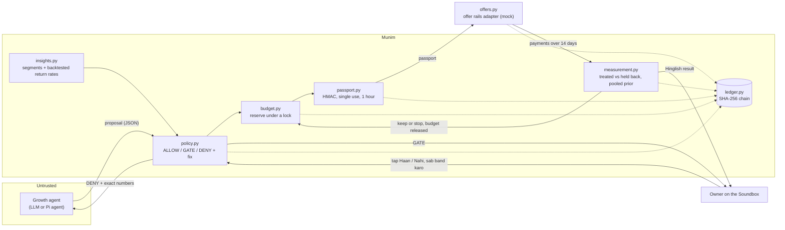

# Architecture

Munim is an ordinary, deterministic program with one optional model at the edge. The growth agent (Paytm's Pi agent, any LLM, or the reference agent in `munim/agent.py`) can only *propose*. Everything that touches money is plain arithmetic in `munim/`, written in integer paise and basis points.



## Authorisation boundaries

| Actor | Can | Cannot |
|---|---|---|
| Growth agent | Read segment summaries and the owner's rules; submit proposals (with `MUNIM_AGENT_TOKEN`); read Munim's reasons and constraints | Supply return rates, baskets or customer lists outside a segment; choose the comparison group; hold keys or money; approve, reject or use the kill switch (403); put its own words on the Soundbox |
| Owner | With `MUNIM_OWNER_TOKEN`: set the rules (budget, margin to keep, approval limit); approve or reject a GATEd offer; stop all spending (cancels running offers and holds new ones); confirm whether a timed-out offer exists | Approve an offer that breaks a DENY rule (approval re-runs every rule; only `approval_required` and `kill_switch` are human-clearable) |
| Munim | Decide; reserve budget; sign a passport bound to one offer, its exact customers and the current rules version; record and seal everything | Spend without a reservation; reuse a passport; retry an uncertain upstream call |
| Offer rails adapter | Create one offer per passport, idempotently; cancel an offer when the owner stops spending | Act without a valid passport (production rails must verify it; the mock does not) |
| Measurement | Read outcomes; release unused budget; mark offers WORKED, UNCERTAIN or STOP | Change the decision record (it is appended to the ledger, not edited) |

## Campaign states (`munim/engine.py`)

```
propose ─┬─ DENY ──────────────────────────────► DENIED
         ├─ GATE ─► PENDING_APPROVAL ─┬─ reject ─► REJECTED
         │                            └─ approve ─► re-check ─┬─ still blocked ─► DENIED
         │                                                    └─ ok ─┐
         └─ ALLOW ───────────────────────────────────────────────────┤
                                                                     ▼
                                       reserve budget + sign passport (AUTHORIZED)
                                                                     │
                       passport refused ─► DENIED (budget released)  │
                       upstream timeout ─► UNKNOWN ─ human ─┬─ exists ─► LIVE
                                                            └─ absent ─► FAILED (released)
                                                     created ─► LIVE ─ kill switch ─► CANCELLED (unspent budget returned;
                                                                     │                   an unclear cancel goes to UNKNOWN)
                                                                     │ outcome after 14 days
                                                     ┌───────────────┴───────────────┐
                                                COMPLETED (kept)              STOPPED (P(profit) < 50%;
                                                                              no rerun for 30 days)
```

Every arrow writes a ledger entry: `POLICY_SET`, `INSIGHTS`, `PROPOSAL`, `DECISION`, `APPROVAL`, `REJECTED`, `AUTHORIZED`, `AUTHORIZATION_FAILED`, `EXECUTED`, `EXECUTION_REFUSED`, `EXECUTION_UNKNOWN`, `UNKNOWN_RESOLVED`, `OUTCOME`, `SPEND_BREACH`, `CANCELLED_BY_OWNER`, `KILL_SWITCH`. Each entry is SHA-256 chained to the one before and sealed with an HMAC key that the export never contains.

## Where AI is used, and where it is not

| Step | Who does it | Why |
|---|---|---|
| Drafting offers and customer messages | The growth agent (LLM) | Creative, language-heavy work where a model helps |
| Segments and return rates | Arithmetic on payments (`insights.py`) | Must be auditable and not something the agent can argue with |
| Allow, ask or refuse | Rules (`policy.py`) | Money decisions must be repeatable and explainable; a model in this path could be talked into overspending |
| Did it pay? | Bayesian measurement (`measurement.py`) | Small groups need uncertainty, not a point estimate |
| Explaining to the owner | Templates with engine numbers (`summary.py`) | The owner hears numbers from the ledger, never from a model |

## What is real and what is mocked

| Part | Prototype | Production with Paytm |
|---|---|---|
| Payments history | Synthetic kirana (`simulator.py`) | Merchant's Paytm transactions, with consent |
| Pooled return rates | 20 synthetic shops | The shop's own recent history where it has enough; similar Paytm shops where it doesn't |
| Offer rails | `MockPaytmOffers`: idempotent, can time out | Paytm offers/cashback APIs behind the same `create_offer` adapter |
| Owner's voice and approvals | Typed in `scripts/demo.py`, HTTP endpoints | AI Soundbox: voice for rules and stopping, a tap to approve; older Soundboxes: the Paytm for Business app |
| Access control | Owner and agent bearer tokens, optional for local demos | Paytm's own merchant and agent identities |
| Storage | In memory, one process | A database with the same append-only ledger, used passports stored until they expire, and the head hash anchored outside Munim |
